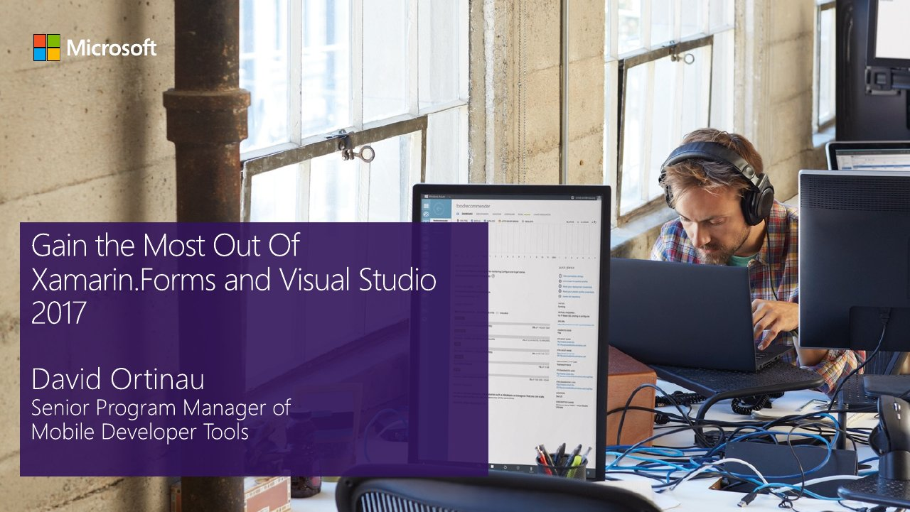

# Getting the Most Out of Xamarin.Forms for Visual Studio 2017

**Xamarin webinar** · Online · April 2017 · [Session page](https://learn.microsoft.com/en-us/shows/xamarin-recent-webinars/getting-most-out-of-xamarinforms-visual-studio-2017)

## Abstract

> David Ortinau shows how to use your .NET skills, XAML expertise, Visual Studio, and Xamarin.Forms to deliver world-class Android, iOS, and UWP apps faster than ever. Dave will share and demo advanced design features, powerful libraries, out-of-the box and custom controls, and new capabilities that you'll want to use immediately.
>
> From tips on improving Android Layout performance and including native controls and APIs to how to save development time with XAMLC, get the expert guidance and step-by-step demos you need to deliver lightning-fast, native apps.
>
> In this webinar, you'll:
> • Build fully native Android, iOS, and UWP apps with XAML
> • Create customized UI with Routing Effects and Platform-Specifics
> • Use bindable, native picker controls to address common UI scenarios
> • Apply XAMLC to get notified of issues at compile-time and boost performance
> • Deliver better UX with deep-linked URLs, custom animations, and more
> • Learn best practices to improve Android performance and use the newest libraries

From the [session page](https://learn.microsoft.com/en-us/shows/xamarin-recent-webinars/getting-most-out-of-xamarinforms-visual-studio-2017).

## Slides

- [PDF](slides.pdf) (23 slides, 1.5 MB)
- [PowerPoint](https://github.com/davidortinau/presentations/releases/download/2017-04-xamarin-webinar-xamarin-forms-vs2017/2017-04-xamarin-webinar-xamarin-forms-vs2017.pptx) (9.5 MB). The speaker notes were removed.

## Video

No recording posted yet.

## Demos

| Demo | Code | As presented |
|---|---|---|
| Webinar demos | [davidortinau/WebinarDemos](https://github.com/davidortinau/WebinarDemos/tree/master), branch `master` | [7057cbd](https://github.com/davidortinau/WebinarDemos/tree/7057cbdda37df8afc5e13989f31132cdb364dd8b) |

---

[All talks](../../README.md)
