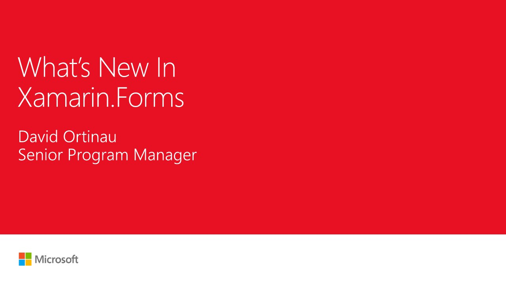

# T128 What's new in Xamarin.Forms

**Microsoft Connect(); 2017** · November 2017 · [Session page](https://learn.microsoft.com/en-us/shows/visual-studio-connect-event-2017/t128)

## Abstract

> Join David in an overview of what's new in Xamarin.Forms, empowering developers to share more code across their iOS, Android, and Windows apps with more flexibility than ever. David also offers a closer look into Xamarin.Forms Native Forms page embedding, Layout Compression, and Fast Renderers.

From the [session page](https://learn.microsoft.com/en-us/shows/visual-studio-connect-event-2017/t128).

## Slides

- [PDF](slides.pdf) (10 slides, 0.3 MB)
- [PowerPoint](https://github.com/davidortinau/presentations/releases/download/2017-11-connect-t128-whats-new-xamarin-forms/2017-11-connect-t128-whats-new-xamarin-forms.pptx) (4.2 MB). This deck has no speaker notes.

## Video

No recording posted yet.

---

[All talks](../../README.md)
