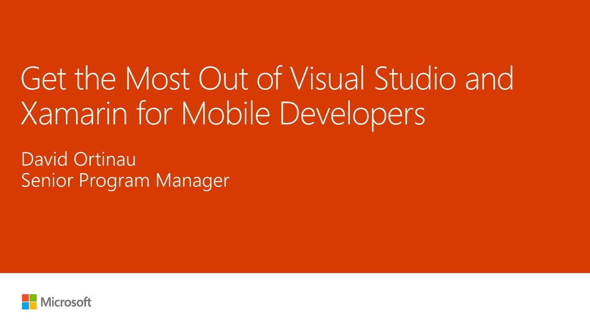

# Getting the Most out of Visual Studio and Xamarin for Mobile Developers

**DevReach 2018** · Sofia, Bulgaria · Tuesday 13 November 2018

## Abstract

> There's never been a better time to jump into mobile development with Xamarin. Microsoft continues to drive innovation for rapidly building Android, iOS, and Windows applications using languages and tools that make you productive. In this session we'll explore the latest additions and improvements in Xamarin, Visual Studio, and App Center for mobile developers. Are you ready to do more?

From the [Speaker Deck](https://speakerdeck.com/davidortinau/getting-the-most-out-of-visual-studio-and-xamarin-for-mobile-developers).

## Slides

- [PDF](slides.pdf) (85 slides, 9.7 MB)
- [PowerPoint](https://github.com/davidortinau/presentations/releases/download/2018-11-13-devreach-visual-studio-xamarin/2018-11-13-devreach-visual-studio-xamarin.pptx) (304.6 MB). The speaker notes were reviewed for public sharing.
- [Slides on Speaker Deck](https://speakerdeck.com/davidortinau/getting-the-most-out-of-visual-studio-and-xamarin-for-mobile-developers)

## Video

No recording posted yet.

---

[All talks](../../README.md)
