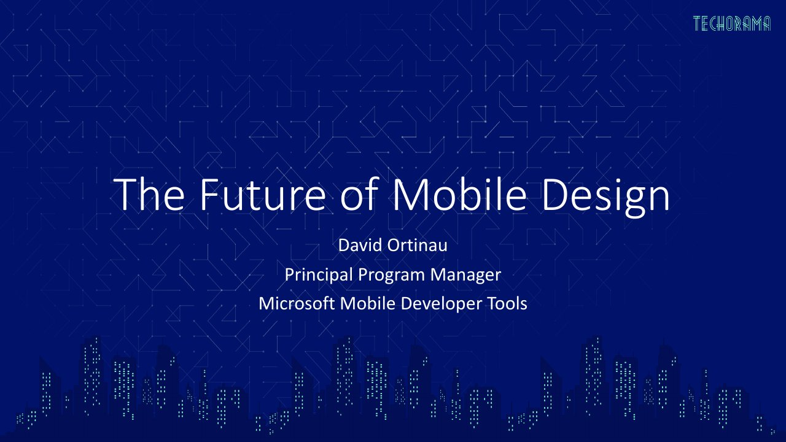

# The Future of Mobile Design

**Techorama NL 2019** · Pathé Ede, Ede, Netherlands · Tuesday 1 October 2019, 11:30 · 60 minutes · [Session page](https://techoramanetherlands2019.sched.com/event/Or9V/the-future-of-mobile-design)

## Abstract

> Microsoft and Xamarin continue to empower new and innovative experiences on mobiles devices. Will we all be designing with Fabric and Fluent UI? Powering interactions with Azure Cognitive Services, Custom Vision, AI, or Machine Learning? In this session we'll gaze into our crystal ball and bask in the amazing potential of these technologies.

From the [session page](https://techoramanetherlands2019.sched.com/event/Or9V/the-future-of-mobile-design).

## Slides

- [PDF](slides.pdf) (24 slides, 4.3 MB)
- [PowerPoint](https://github.com/davidortinau/presentations/releases/download/2019-10-01-techorama-nl-future-of-mobile-design/2019-10-01-techorama-nl-future-of-mobile-design.pptx) (43.2 MB). The speaker notes were reviewed for public sharing.

## Video

No recording posted yet.

---

[All talks](../../README.md)
