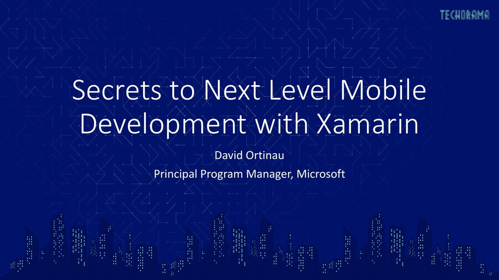

# Secrets To Next Level Mobile Development with Xamarin

**Techorama NL 2019** · Pathé Ede, Ede, Netherlands · Wednesday 2 October 2019, 10:00 · 60 minutes · [Session page](https://techoramanetherlands2019.sched.com/event/Or9T/secrets-to-next-level-mobile-development-with-xamarin)

## Abstract

> You don't have to tell your boss. There's nothing really sinister about these secrets. Actually, it's just being plain smart about how you rapidly build beautiful mobile experiences with Xamarin and Visual Studio. The Xamarin and Visual Studio teams have been hard at work improving the SDKs and tools based on your feedback. In this session I'll unveil all the latest tools from Microsoft that will make you feel like 10x your former self when building mobile apps with Xamarin.

From the [session page](https://techoramanetherlands2019.sched.com/event/Or9T/secrets-to-next-level-mobile-development-with-xamarin).

## Slides

- [PDF](slides.pdf) (27 slides, 4.2 MB)
- [PowerPoint](https://github.com/davidortinau/presentations/releases/download/2019-10-02-techorama-nl-next-level-xamarin/2019-10-02-techorama-nl-next-level-xamarin.pptx) (53.6 MB). The speaker notes were reviewed for public sharing.

## Video

No recording posted yet.

## Resources

- [Xamarin Hot Restart](https://aka.ms/xamarin-hotrestart)

---

[All talks](../../README.md)
