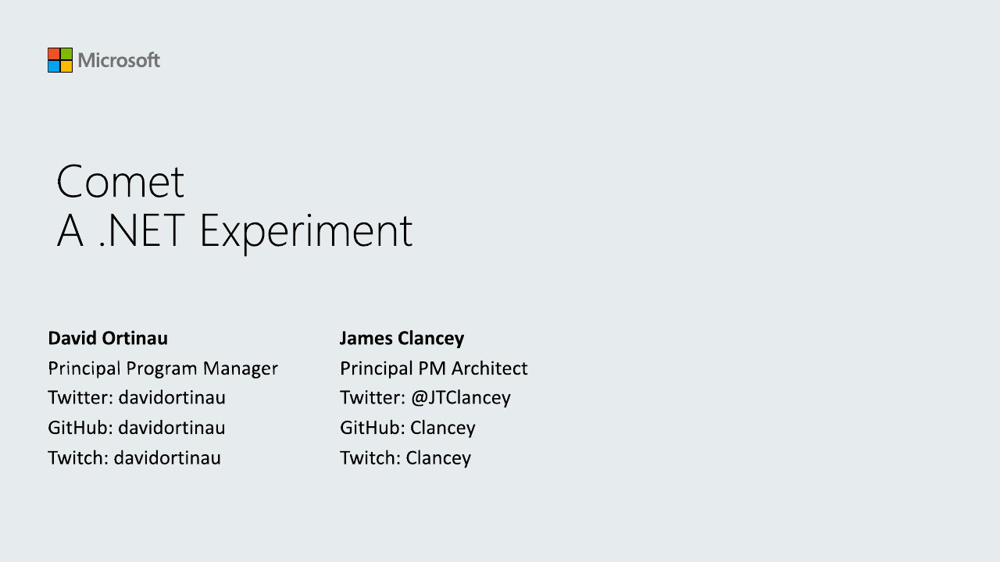

# Comet: A .NET Experiment

**Modern App Dev Network Belgium (MADN)** · Franklin Rooseveltplaats 12, Antwerp, Belgium · Thursday 3 October 2019, 18:30

## Abstract

No published abstract.

## Slides

- [PDF](slides.pdf) (19 slides, 2.8 MB)
- [PowerPoint](https://github.com/davidortinau/presentations/releases/download/2019-10-03-madn-antwerp-comet/2019-10-03-madn-antwerp-comet.pptx) (103.5 MB). The speaker notes were reviewed for public sharing.

## Video

No recording posted yet.

## Demos

| Demo | Code | As presented |
|---|---|---|
| Comet | [Clancey/Comet](https://github.com/Clancey/Comet) |   |

## Resources

- [Comet on GitHub](https://github.com/Clancey/Comet)

---

[All talks](../../README.md)
