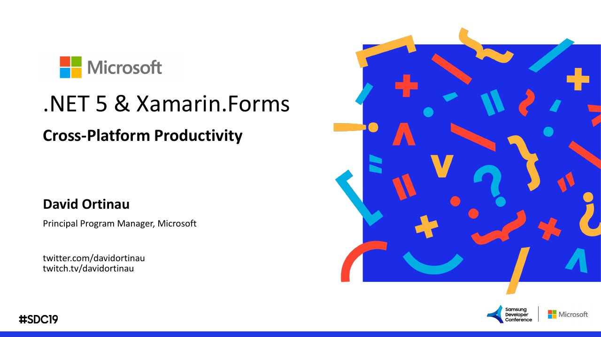

# What's New in Tizen? 5.5 Platform Update and Developer Environment

**Samsung Developer Conference 2019** · Session Room 212, San Jose, United States · Wednesday 30 October 2019, 12:30 · 45 minutes · [Session page](https://www.samsungdeveloperconference.com/schedule/session/1089296)

With Hobum Vincent Kwon, Diego Lizarazo Rivera.

## Abstract

No published abstract.

## Slides

- [PDF](slides.pdf) (17 slides, 3.7 MB)
- [PowerPoint](https://github.com/davidortinau/presentations/releases/download/2019-10-30-samsung-dev-conf-tizen-5-5/2019-10-30-samsung-dev-conf-tizen-5-5.pptx) (32.8 MB). The speaker notes were reviewed for public sharing.

## Video

- [Video on the Samsung Developer channel](https://www.youtube.com/watch?v=fU5Yx8M0KOk)

## Demos

| Demo | Code | As presented |
|---|---|---|
| Tizen .NET demos, samples and resources from SDC 2019 | [rookiejava/sdc2019-tizen-net](https://github.com/rookiejava/sdc2019-tizen-net/tree/master), branch `master` | [9b97b5d](https://github.com/rookiejava/sdc2019-tizen-net/tree/9b97b5dc67c3e0f31e36076389323b1198883361) |

## Resources

- [dotnet-presentations](https://github.com/dotnet-presentations/home)

---

[All talks](../../README.md)
