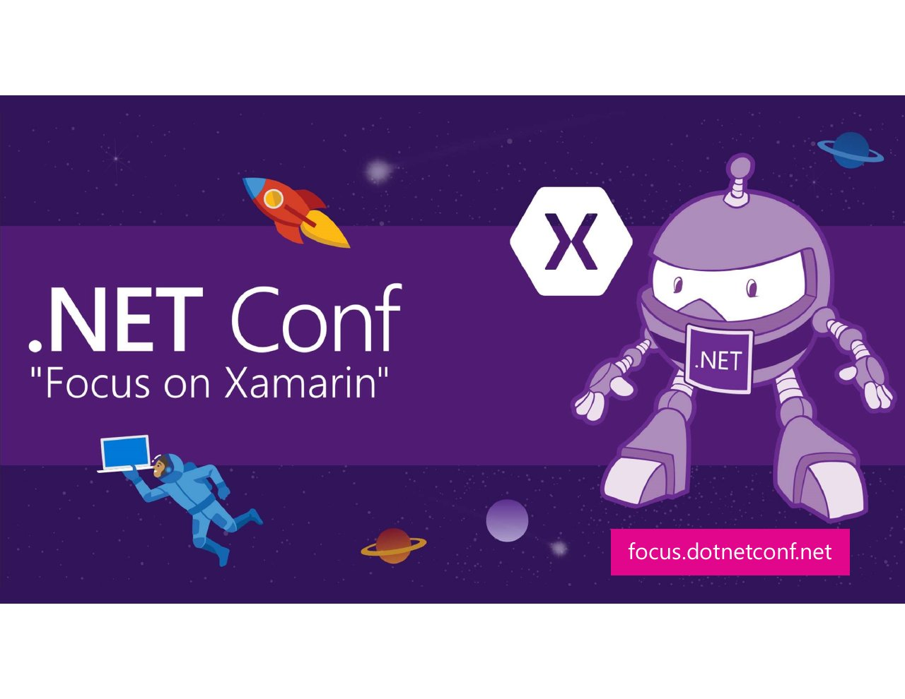

# Keynote: Xamarin All The Things

**.NET Conf: Focus on Xamarin 2020** · March 2020 · [Session page](https://learn.microsoft.com/en-us/shows/dotnetconf-focus-on-xamarin/xamarin-all-the-things)

With Amanda Silver, [Maddy Leger](https://github.com/maddymontaquila).

## Abstract

> Join Maddy, David, and Amanda as they kick off a day full of Xamarin and .NET. Find out what is new and awesome for Xamarin developers to build stunning cross-platform mobile apps with .NET and Visual Studio. You do not want to miss out!
>
> For more information on Xamarin head over to https://aka.ms/XamarinFocus

From the [session page](https://learn.microsoft.com/en-us/shows/dotnetconf-focus-on-xamarin/xamarin-all-the-things).

## Slides

- [PDF](slides.pdf) (57 slides, 9.1 MB)

## Video

- [Recording on the dotnet YouTube channel](https://youtu.be/tRNOLKq4_jo)

## Demos

| Demo | Code | As presented |
|---|---|---|
| MonkeysRefresh | [maddymontaquila/MonkeysRefresh](https://github.com/maddymontaquila/MonkeysRefresh/tree/xamarin-net-conf), branch `xamarin-net-conf` | [3ea8cd4](https://github.com/maddymontaquila/MonkeysRefresh/tree/3ea8cd4cbd50eca842a4b7c4936b88e7872cdd0c) |

## Resources

- [Xamarin Focus event page](https://aka.ms/XamarinFocus)
- [XAML Hot Reload docs](https://aka.ms/XAMLHotReloadDocs)
- [Hot Restart docs](https://aka.ms/HotRestartDocs)

---

[All talks](../../README.md)
