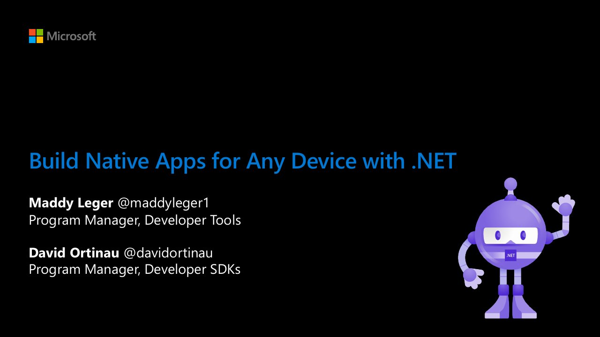

# BOD107 Build native apps for any device with .NET

**Build 2020** · Online · Tuesday 19 May 2020 · [Session page](https://learn.microsoft.com/en-us/shows/build-2020/bod107)

With [Maddy Leger](https://github.com/maddymontaquila).

## Abstract

> Learn about recent Xamarin features and Visual Studio productivity gains you can take advantage of today, as well as peek into the future of building native, cross-platform apps with .NET.

From the [session page](https://learn.microsoft.com/en-us/shows/build-2020/bod107).

## Slides

- [PDF](slides.pdf) (61 slides, 7.6 MB)
- [PowerPoint](https://github.com/davidortinau/presentations/releases/download/2020-05-19-build-bod107-native-apps-any-device/2020-05-19-build-bod107-native-apps-any-device.pptx) (67.7 MB). The speaker notes were reviewed for public sharing.
- [Original deck in dotnet-presentations/Build (Git LFS)](https://github.com/dotnet-presentations/Build/blob/master/2020/2020_05_19_Xamarin_Build.pptx)

## Video

- [Recording on Microsoft Learn](https://learn.microsoft.com/en-us/shows/build-2020/bod107)

## Resources

- [Xamarin.Forms roadmap](https://aka.ms/xf-roadmap)
- [.NET MAUI proposals](https://github.com/dotnet/maui)
- [Good UI samples from the community (Javier Suarez)](https://aka.ms/xf-good-ui)

---

[All talks](../../README.md)
