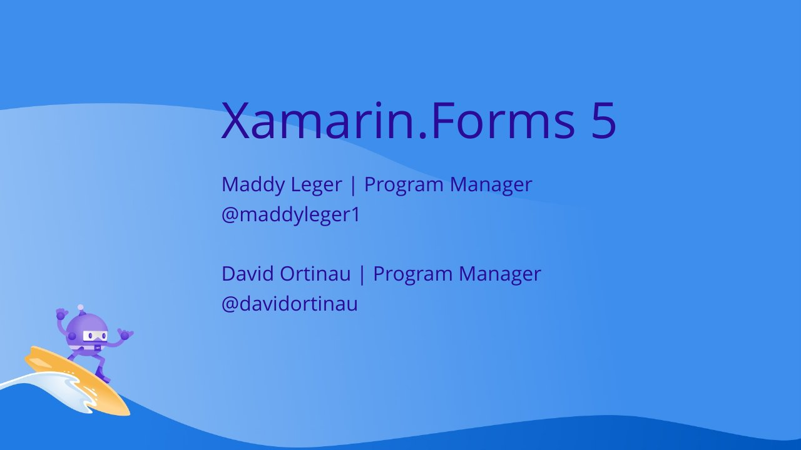

# Xamarin.Forms 5: Beautiful and Fast Apps with Less Code

**.NET Conf 2020** · Online · November 2020

With [Maddy Leger](https://github.com/maddymontaquila).

## Abstract

> Xamarin.Forms 5 is jam-packed with new features to make it easier than ever to develop fast, beautiful, cross-platform apps. Come see what new features are in Xamarin.Forms 5, and learn more about how our Xamarin Community Toolkit is getting more features than ever into your hands!

From the [Official .NET YouTube video description](https://www.youtube.com/watch?v=M7UVz82dE90).

## Slides

- [PDF](slides.pdf) (26 slides, 6.8 MB)
- [PowerPoint](https://github.com/davidortinau/presentations/releases/download/2020-11-dotnet-conf-xamarin-forms-5/2020-11-dotnet-conf-xamarin-forms-5.pptx) (19.5 MB). This deck has no speaker notes.

## Video

- [Recording (.NET YouTube channel)](https://www.youtube.com/watch?v=M7UVz82dE90)

## Demos

| Demo | Code | As presented |
|---|---|---|
| Los Gatos sample app | [davidortinau/LosGatos](https://github.com/davidortinau/LosGatos/tree/main), branch `main` | [015c3ec](https://github.com/davidortinau/LosGatos/tree/015c3ec59e60c7acc970650c5bfe4750936927ef) |

## Resources

- [Xamarin.Forms 5 preview](https://aka.ms/xf-5)
- [Xamarin Community Toolkit](https://github.com/xamarin/xamarincommunitytoolkit)

---

[All talks](../../README.md)
