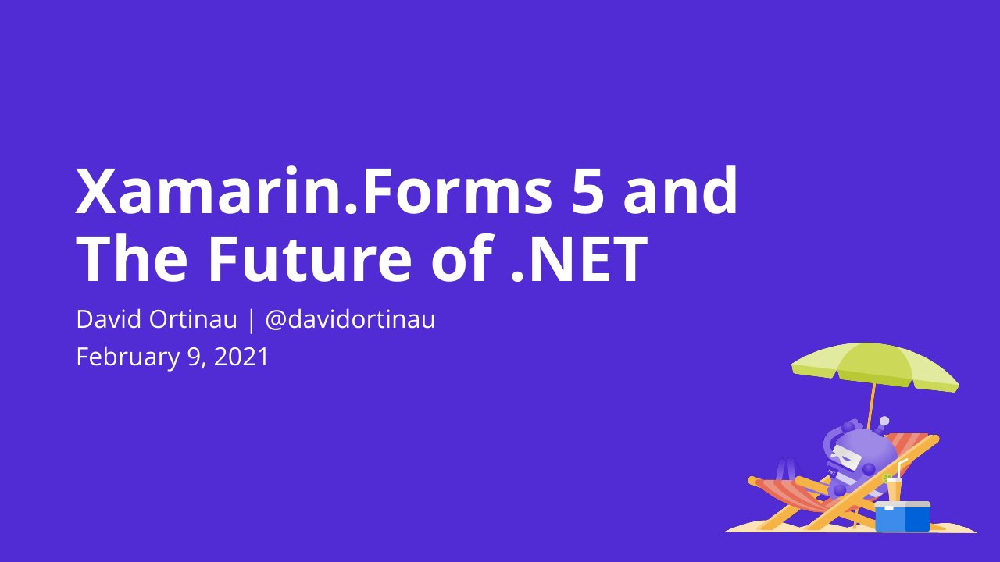

# Xamarin.Forms 5 and the Future of .NET

**Tech Valley .NET User Group** · Online · Tuesday 9 February 2021

## Abstract

> Let’s celebrate the latest release of Xamarin.Forms, and put it in context for what .NET developers can expect to see from Microsoft over the next few years. Mobile, desktop, and even web are important targets for many applications. How is Microsoft working to address these demanding business needs, and what does this practically mean for you, the client application developer? We will discuss Xamarin.Forms, .NET 6, .NET MAUI, Mac Catalyst, WinUI 3, and more.

From the [video description (TVUG channel)](https://www.youtube.com/watch?v=ReGAMeTK71s).

## Slides

- [PDF](slides.pdf) (36 slides, 4.9 MB)
- [PowerPoint](https://github.com/davidortinau/presentations/releases/download/2021-02-09-tech-valley-ug-xamarin-forms-5/2021-02-09-tech-valley-ug-xamarin-forms-5.pptx) (23.3 MB). The speaker notes were reviewed for public sharing.

## Video

- [Recording (YouTube, TVUG channel)](https://www.youtube.com/watch?v=ReGAMeTK71s)

---

[All talks](../../README.md)
