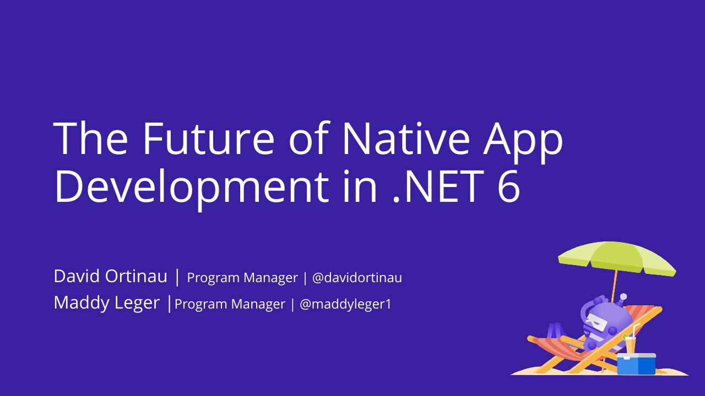

# The Future of Native Apps Development in .NET 6

**.NET Conf: Focus on Windows** · Online · Thursday 25 February 2021 · [Session page](https://learn.microsoft.com/en-us/shows/dotnetconf-focus-on-windows/the-future-of-native-apps-development-in-net-6)

With [Maddy Montaquila](https://github.com/maddymontaquila).

## Abstract

> .NET Multi-platform App UI (.NET MAUI) is a framework for building cross-platform desktop, tablet, and mobile apps with a single codebase. It's in early preview and will be available with .NET 6. Come see how you can build native apps for Windows, macOS, iOS and Android all at the same time.

From the [Microsoft Learn show page](https://learn.microsoft.com/en-us/shows/dotnetconf-focus-on-windows/the-future-of-native-apps-development-in-net-6).

## Slides

- [PDF](slides.pdf) (28 slides, 4.6 MB)
- [PowerPoint](https://github.com/davidortinau/presentations/releases/download/2021-02-25-dotnet-conf-focus-windows-native-apps-net-6/2021-02-25-dotnet-conf-focus-windows-native-apps-net-6.pptx) (44.9 MB). The speaker notes were reviewed for public sharing.

## Video

- [Recording (YouTube, .NET channel)](https://www.youtube.com/watch?v=fPEdgXeqhE4)

---

[All talks](../../README.md)
