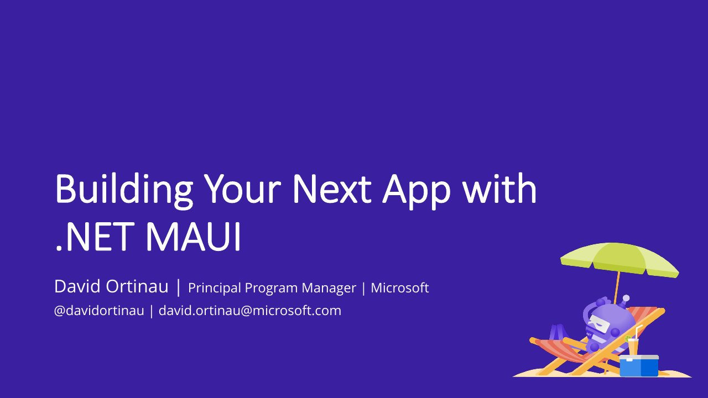

# Building Your Next App with .NET MAUI

**Cologne .NET User Group** · Online · Friday 14 May 2021

## Abstract

> .NET 6 simplifies the myriad of choices you face when choosing how to build your next mobile, desktop, web, or cross-platform application. At the core of this is .NET Multi-platform App UI (MAUI). In this session David will introduce the .NET MAUI architecture, how it relates to other parts of .NET such as Blazor, demonstrate the latest productivity features, and answer your .NET MAUI questions.

From the [Video description on Tobias Hoppenthaler's YouTube channel](https://www.youtube.com/watch?v=6qrQax2Jqnw).

## Slides

- [PDF](slides.pdf) (27 slides, 2.8 MB)
- [PowerPoint](https://github.com/davidortinau/presentations/releases/download/2021-05-14-cologne-ug-next-app-with-maui/2021-05-14-cologne-ug-next-app-with-maui.pptx) (14.8 MB). The speaker notes were reviewed for public sharing.

## Video

- [David Ortinau - Building Your Next App with .NET MAUI (Tobias Hoppenthaler)](https://www.youtube.com/watch?v=6qrQax2Jqnw)

## Also presented at

- [Xamarin Expert Day 2021, Friday 1 October 2021](../../2021/2021-10-01-xamarin-expert-day-next-maui-app/)

---

[All talks](../../README.md)
