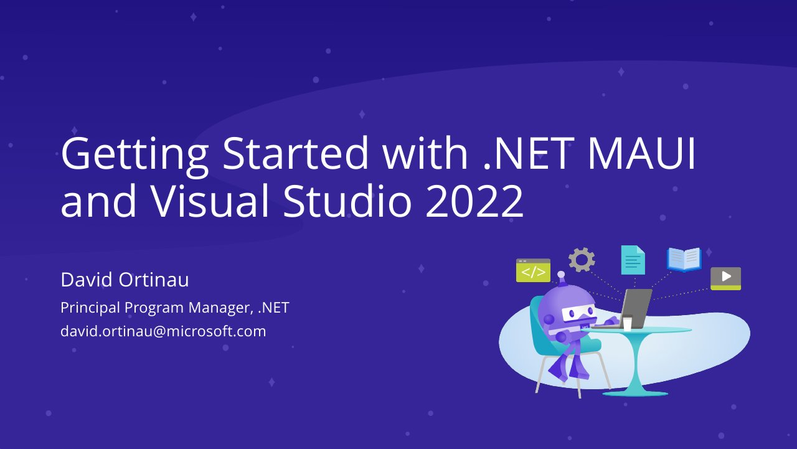

# Getting Started with .NET MAUI and Visual Studio 2022

**Microsoft Reactor .NET Day in China** · Microsoft Reactor Shanghai, Shanghai, China · Saturday 24 July 2021 · [Session page](https://segmentfault.com/e/1160000040381920)

## Abstract

> .NET MAUI 使你能够从一个代码库为 Android、iOS、macOS 和 Windows 构建丰富的、功能齐全的本地应用程序。与 Visual Studio 2022 相结合，您将拥有最高效的组合来快速开发应用程序并将它们交付给客户。在这一节中，我们将介绍 .NET MAUI 的特性，开发经验，以及如何从 Visual Studio 2022 现在和即将发布的版本中获得最大的好处。

From the [SegmentFault event page (agenda, in Chinese)](https://segmentfault.com/e/1160000040381920).

## Slides

- [PDF](slides.pdf) (47 slides, 7.4 MB)
- [PowerPoint](https://github.com/davidortinau/presentations/releases/download/2021-07-24-reactor-dotnet-day-china-maui-vs2022/2021-07-24-reactor-dotnet-day-china-maui-vs2022.pptx) (85.5 MB). The speaker notes were reviewed for public sharing.

## Video

No recording posted yet.

---

[All talks](../../README.md)
