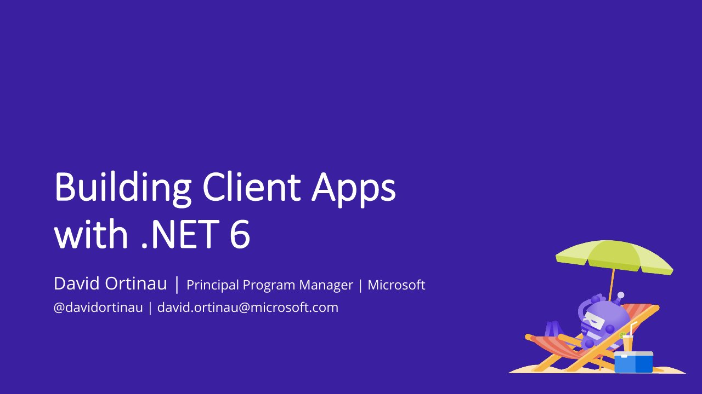

# Building Client Apps with .NET 6

**St. Louis .NET User Group** · St. Louis, United States · September 2021

## Abstract

No published abstract.

## Slides

- [PDF](slides.pdf) (48 slides, 5.7 MB)
- [PowerPoint](https://github.com/davidortinau/presentations/releases/download/2021-09-st-louis-dotnet-ug-net-6-apps/2021-09-st-louis-dotnet-ug-net-6-apps.pptx) (73.9 MB). The speaker notes were reviewed for public sharing.

## Video

No recording posted yet.

## Resources

- [.NET MAUI on GitHub](https://github.com/dotnet/maui)
- [.NET Conf](https://www.dotnetconf.net)

---

[All talks](../../README.md)
