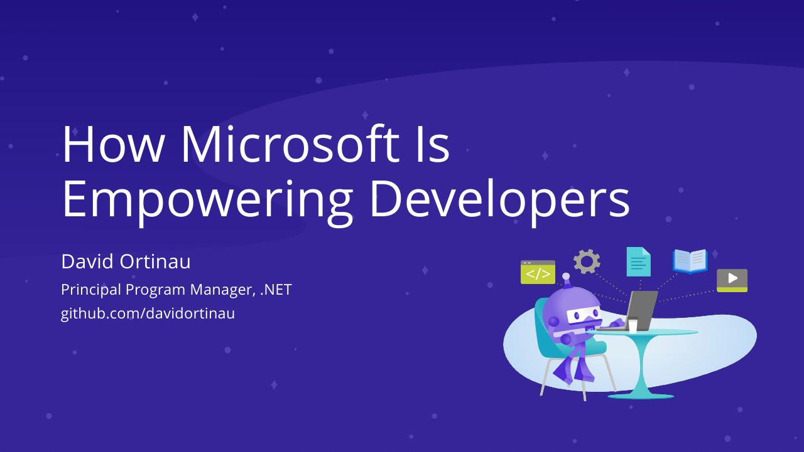

# How Microsoft Is Empowering Developers

**UBT International Conference 2021 (IC-UBT 2021)** · Online · Friday 29 October 2021, 17:00 · 15 minutes

## Abstract

No published abstract.

## Slides

- [PDF](slides.pdf) (21 slides, 5.4 MB)
- [PowerPoint](https://github.com/davidortinau/presentations/releases/download/2021-10-29-ubt-empowering-developers/2021-10-29-ubt-empowering-developers.pptx) (46.0 MB). The speaker notes were reviewed for public sharing.

## Video

No recording posted yet.

## Demos

| Demo | Code | As presented |
|---|---|---|
| WeatherTwentyOne (.NET MAUI sample app) | [davidortinau/WeatherTwentyOne](https://github.com/davidortinau/WeatherTwentyOne/tree/main), branch `main` | [a8966c5](https://github.com/davidortinau/WeatherTwentyOne/tree/a8966c57587a4c2707c25b6eace14d8463682416) |

## Resources

- [.NET customers](http://dot.net/customers)
- [.NET Conf](https://www.dotnetconf.net)
- [.NET MAUI on GitHub](https://github.com/dotnet/maui)

---

[All talks](../../README.md)
