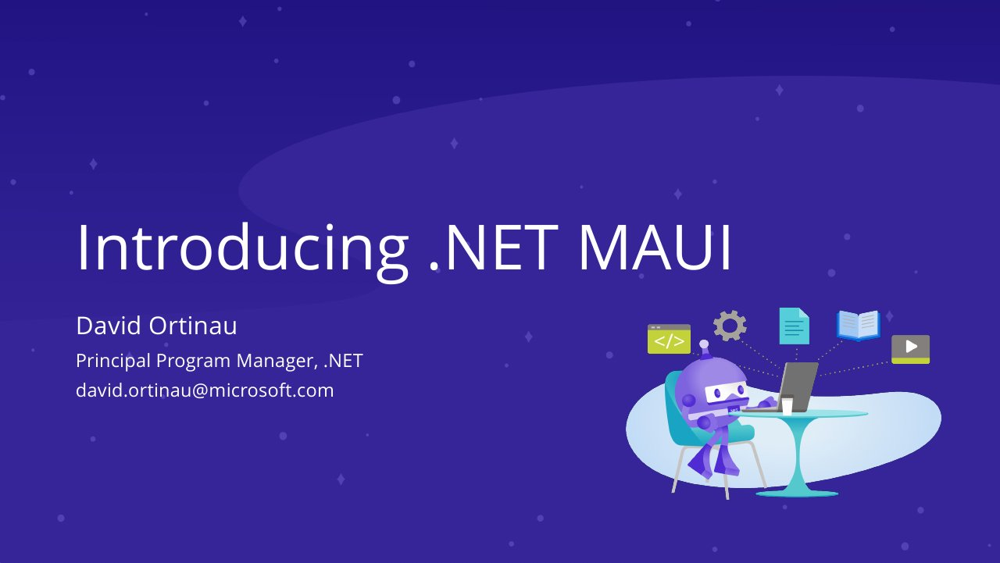

# Introducing .NET MAUI

**Dot Net North, March 2022** · March 2022

## Abstract

> MAUI is a cross-platform framework for creating native mobile and desktop apps with C# and XAML.

From the [official video description](https://www.youtube.com/watch?v=rOJtZrMUAIM).

## Slides

- [PDF](slides.pdf) (21 slides, 6.4 MB)
- [PowerPoint](https://github.com/davidortinau/presentations/releases/download/2022-03-dot-net-north-intro-to-maui/2022-03-dot-net-north-intro-to-maui.pptx) (47.4 MB). The speaker notes were reviewed for public sharing.

## Video

- [Recording (Dot Net North)](https://www.youtube.com/watch?v=rOJtZrMUAIM)

## Resources

- [dotnet-podcasts sample app](https://github.com/microsoft/dotnet-podcasts)
- [WeatherTwentyOne sample app](https://github.com/davidortinau/WeatherTwentyOne)

---

[All talks](../../README.md)
