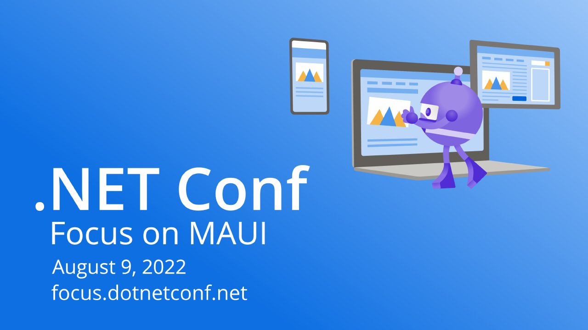

# Welcome to .NET MAUI!

**.NET Conf: Focus on MAUI 2022** · Tuesday 9 August 2022 · [Session page](https://learn.microsoft.com/en-us/shows/dotnetconf-focus-on-maui/welcome-to-dotnet-maui)

With [Maddy Montaquila](https://github.com/maddymontaquila).

## Abstract

> Maddy and David open the day with an introduction to .NET Multi-platform App UI, why it's an important framework for .NET developers, and some of the momentum they're seeing in the .NET ecosystem around native client development.

From the [session page](https://learn.microsoft.com/en-us/shows/dotnetconf-focus-on-maui/welcome-to-dotnet-maui).

## Slides

- [PDF](slides.pdf) (39 slides, 13.7 MB)
- [PowerPoint](https://github.com/davidortinau/presentations/releases/download/2022-08-09-dotnet-conf-focus-on-maui-keynote/2022-08-09-dotnet-conf-focus-on-maui-keynote.pptx) (23.3 MB). The speaker notes were reviewed for public sharing.
- [Keynote deck in dotnet-presentations/dotNETConf](https://github.com/dotnet-presentations/dotNETConf/blob/main/2022/FocusOnMAUI/Technical/dotnetconf-MAUI-Keynote.pptx)

## Video

- [Recording on Microsoft Learn](https://learn.microsoft.com/en-us/shows/dotnetconf-focus-on-maui/welcome-to-dotnet-maui)

## Resources

- [.NET MAUI documentation](https://learn.microsoft.com/dotnet/maui/)
- [dotnet-podcasts sample app](https://github.com/microsoft/dotnet-podcasts)
- [.NET MAUI samples](https://github.com/dotnet/maui-samples)

---

[All talks](../../README.md)
