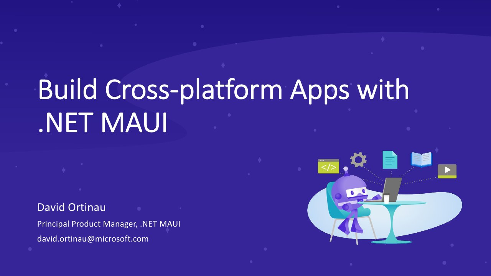

# Build Cross-platform Apps with .NET MAUI

**DevReach 2022** · The Westin Boston Seaport District, Boston, United States · October 2022 · [Session page](https://www.youtube.com/watch?v=T99XQ2rpCd0)

## Abstract

> In this DevReach 2022 session, David Ortinau, Pr. Program Manager at Microsoft, talks about multi-platform client app development for all .NET developers.
>
> .NET 6 for the first time ever introduces "in the box" support for building client applications that target Android, iOS, macOS, and Windows from a single codebase. With so many great features included, David focuses on his favorites that will make your apps shine, make your code sparkle, and help you be more productive than ever. We will cover topics such as:
>
> - .NET MAUI controls, custom controls, styling, and native platform integrations
> - XAML and markup extension power tips
> - Building fluent C# UI for the XAML-allergic
> - Productivity developer tips in Visual Studio 2022

From the [video description](https://www.youtube.com/watch?v=T99XQ2rpCd0).

## Slides

- [PDF](slides.pdf) (24 slides, 5.0 MB)
- [PowerPoint](https://github.com/davidortinau/presentations/releases/download/2022-10-devreach-cross-platform-maui/2022-10-devreach-cross-platform-maui.pptx) (78.6 MB). The speaker notes were reviewed for public sharing.

## Video

- [Build Cross-platform Apps with .NET MAUI | DevReach 2022 (YouTube, Progress Telerik channel)](https://www.youtube.com/watch?v=T99XQ2rpCd0)

## Resources

- [.NET MAUI home](http://dotnetmaui.dev)
- [.NET MAUI documentation](http://docs.microsoft.com/dotnet/maui)
- [.NET MAUI on GitHub](http://github.com/dotnet/maui)
- [Awesome .NET MAUI](https://github.com/jsuarezruiz/awesome-dotnet-maui)
- [.NET Live TV](https://live.dot.net)

---

[All talks](../../README.md)
