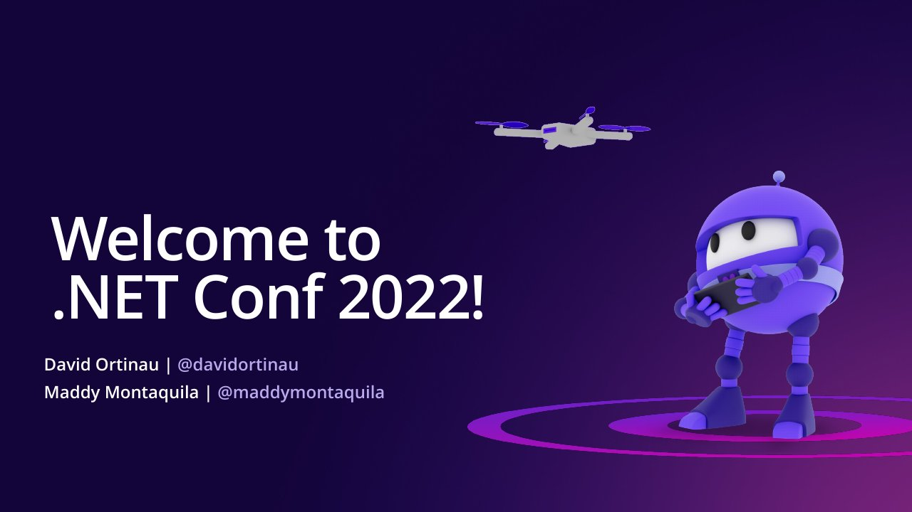

# State of .NET MAUI

**.NET Conf 2022** · Online · Tuesday 8 November 2022 · [Session page](https://learn.microsoft.com/en-us/shows/dotnetconf-2022/state-of-dotnet-maui)

With [Maddy Montaquila](https://github.com/maddymontaquila).

## Abstract

> This has been a big year for .NET MAUI and .NET developers building mobile, desktop, and cross-platform apps. So much has happened already, and we have even more announcements to share today. Join product managers Maddy Montaquila and David Ortinau for a brief State of the Union to catch up on all the latest news, and a peek at the road ahead.

From the [session page](https://learn.microsoft.com/en-us/shows/dotnetconf-2022/state-of-dotnet-maui).

## Slides

- [PDF](slides.pdf) (26 slides, 9.1 MB)
- [Slides in the dotnet-presentations .NET Conf repository](https://github.com/dotnet-presentations/dotNETConf/blob/main/2022/MainEvent/Technical/David_Ortinau_Maddy_Montaquila_State_Of_MAUI.pptx)

## Video

- [State of .NET MAUI | .NET Conf 2022 (YouTube, dotnet channel)](https://www.youtube.com/watch?v=Z6UPJmerTo8)

## Resources

- [.NET MAUI performance in .NET 7](https://aka.ms/maui-7-perf)
- [Download .NET 7](https://get.dot.net/7)

---

[All talks](../../README.md)
