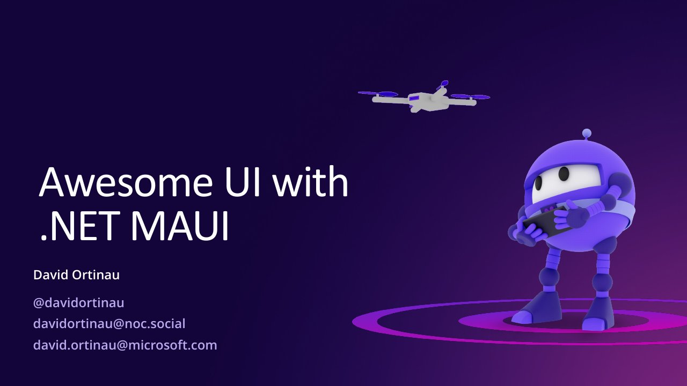

# Awesome UI with .NET MAUI

**DEVintersection 2022** · Las Vegas, United States · December 2022

## Abstract

No published abstract.

## Slides

- [PDF](slides.pdf) (37 slides, 15.2 MB)
- [PowerPoint](https://github.com/davidortinau/presentations/releases/download/2022-12-devintersection-awesome-ui-maui/2022-12-devintersection-awesome-ui-maui.pptx) (77.3 MB). The speaker notes were reviewed for public sharing.

## Video

No recording posted yet.

## Resources

- [Customization with handlers (Microsoft Learn)](https://learn.microsoft.com/en-us/dotnet/maui/user-interface/handlers/customize)
- [.NET MAUI Community Toolkit](https://github.com/CommunityToolkit/Maui)
- [ToDoEntry control composition sample](https://github.com/davidortinau/ToDoEntry/)
- [Awesome .NET MAUI](https://github.com/jsuarezruiz/awesome-dotnet-maui)
- [.NET MAUI samples](https://github.com/dotnet/maui-samples)

---

[All talks](../../README.md)
