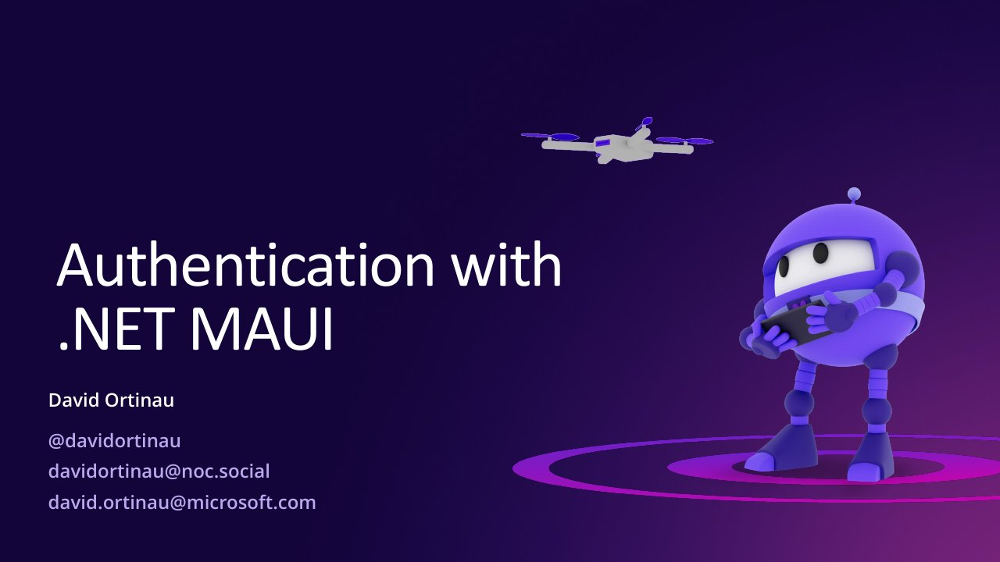

# Authentication with .NET MAUI

**DEVintersection 2022** · Las Vegas, United States · December 2022

## Abstract

No published abstract.

## Slides

- [PDF](slides.pdf) (23 slides, 5.4 MB)
- [PowerPoint](https://github.com/davidortinau/presentations/releases/download/2022-12-devintersection-maui-auth/2022-12-devintersection-maui-auth.pptx) (50.2 MB). The speaker notes were reviewed for public sharing.

## Video

No recording posted yet.

## Resources

- [MSAL.NET with .NET MAUI sample](https://github.com/Azure-Samples/ms-identity-dotnetcore-maui)
- [Azure Mobile Apps (Datasync)](https://github.com/Azure/azure-mobile-apps)
- [WebAuthenticator (Microsoft Learn)](https://learn.microsoft.com/dotnet/maui/platform-integration/communication/authentication)
- [Add authentication to .NET MAUI apps with Auth0](https://auth0.com/blog/add-authentication-to-dotnet-maui-apps-with-auth0/)

---

[All talks](../../README.md)
