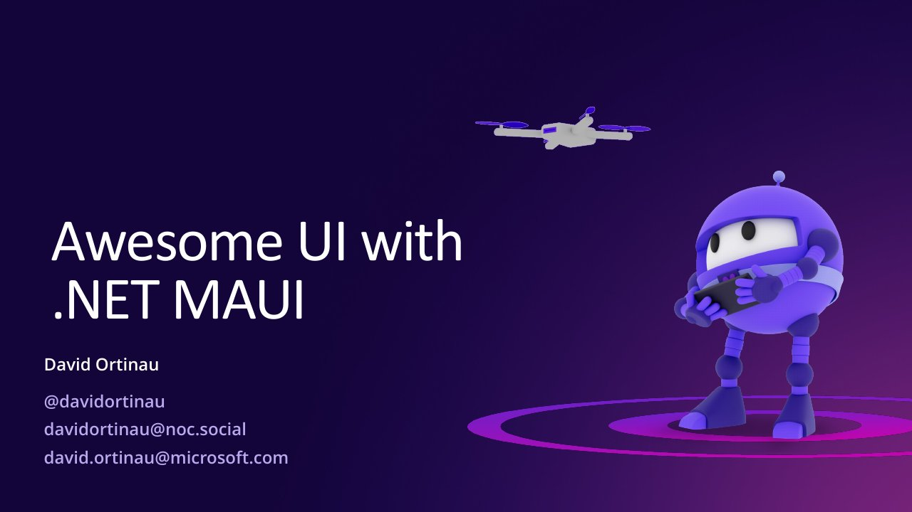

# Awesome UI with .NET MAUI

**XamExpertDay 2023** · Microsoft Office Cologne, Cologne, Germany · Monday 6 February 2023, 08:45 · 50 minutes · [Session page](https://mauiday.net/archive/cologne-2023)

## Abstract

> Whether building an app for consumers or enterprises, for games or line-of-business apps, you can do it all with .NET MAUI. In this session, I'll share my pro tips from 25 years of developing beautiful UIs for desktop, mobile, and web applications. Going cross-platform doesn't mean you need to sacrifice amazing design. Making UI beautiful doesn't mean you need to sacrifice usability and accessibility.

From the [session page](https://mauiday.net/archive/cologne-2023).

## Slides

- [PDF](slides.pdf) (37 slides, 17.8 MB)
- [PowerPoint](https://github.com/davidortinau/presentations/releases/download/2023-02-06-xamarin-expert-day-cologne-awesome-ui-maui/2023-02-06-xamarin-expert-day-cologne-awesome-ui-maui.pptx) (81.3 MB). The speaker notes were reviewed for public sharing.

## Video

No recording posted yet.

## Also presented at

- [Swetugg Stockholm 2023, February 2023](../../2023/2023-02-swetugg-awesome-ui-maui/)

## Resources

- [C# UI tutorial with the .NET MAUI Community Toolkit](https://learn.microsoft.com/en-us/windows/apps/windows-dotnet-maui/tutorial-csharp-ui-maui-toolkit)
- [ToDoEntry control composition sample](https://github.com/davidortinau/ToDoEntry/)
- [Customize controls with handlers](https://learn.microsoft.com/en-us/dotnet/maui/user-interface/handlers/customize)
- [Awesome .NET MAUI](https://github.com/jsuarezruiz/awesome-dotnet-maui)
- [.NET MAUI samples](https://github.com/dotnet/maui-samples)

---

[All talks](../../README.md)
