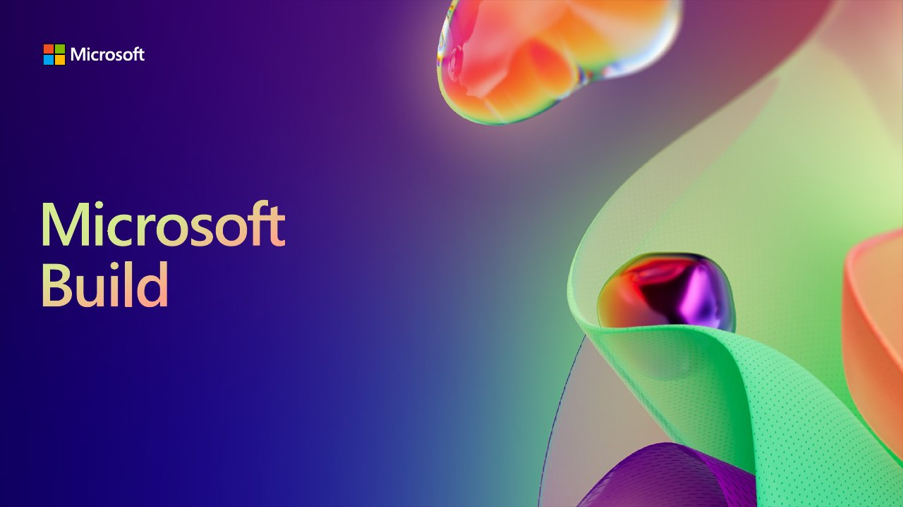

# BRK204 All things client and mobile app development with .NET MAUI

**Build 2023** · Seattle, United States · May 2023

With [Maddy Montaquila](https://github.com/maddymontaquila), Rod Ball.

## Abstract

> Code, test, ship, and continuously improve your mobile and desktop applications with the latest release of .NET Multi-platform App UI (MAUI). From the latest UI controls and native platform integrations on Android, iOS, macOS, and Windows to sharing more code with web technologies like Blazor, Angular, and ReactJS, learn how can achieve more with .NET MAUI, Visual Studio, and Microsoft Azure.

From the [Official Microsoft Build 2023 video description (Microsoft Developer channel)](https://www.youtube.com/watch?v=-4SJvzGNZ_M).

## Slides

- [PDF](slides.pdf) (41 slides, 11.4 MB)
- [PowerPoint](https://github.com/davidortinau/presentations/releases/download/2023-05-build-brk204-client-mobile-maui/2023-05-build-brk204-client-mobile-maui.pptx) (121.0 MB). The speaker notes were reviewed for public sharing.

## Video

- [All things client and mobile app development with .NET MAUI | BRK204 (Microsoft Developer)](https://www.youtube.com/watch?v=-4SJvzGNZ_M)

## Resources

- [Build 2023 BRK204 Microsoft Learn collection](https://learn.microsoft.com/en-us/collections/4x0quom2kz6r4e)
- [.NET Upgrade Assistant general availability (upgrading Xamarin.Forms to .NET MAUI)](https://devblogs.microsoft.com/dotnet/upgrade-assistant-general-availability/#upgrades-from-xamarin-forms-to-net-maui)
- [HybridWebView (experimental) for Angular, React and Vue](https://aka.ms/MauiHybridWebView)
- [.NET MAUI performance in .NET 7](https://aka.ms/maui-7-perf)

---

[All talks](../../README.md)
