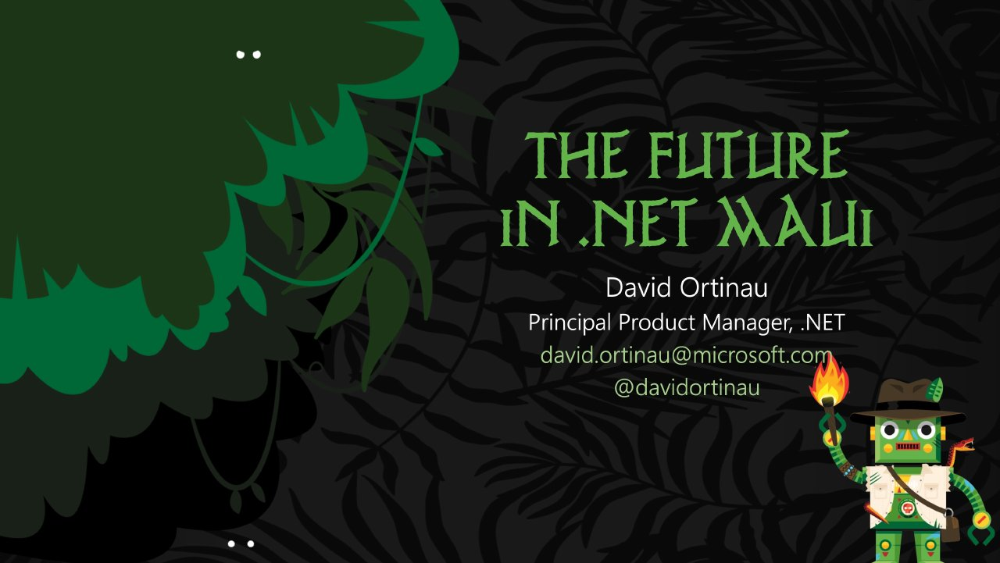

# The Future in .NET MAUI

**Techorama BE 2023** · Kinepolis Antwerp, Antwerp, Belgium · May 2023

## Abstract

No published abstract.

## Slides

- [PDF](slides.pdf) (28 slides, 15.7 MB)
- [PowerPoint](https://github.com/davidortinau/presentations/releases/download/2023-05-techorama-be-future-in-maui/2023-05-techorama-be-future-in-maui.pptx) (260.1 MB). The speaker notes were reviewed for public sharing.

## Video

No recording posted yet.

## Also presented at

- [DevReach 2023, November 2023](../../2023/2023-11-devreach-future-in-maui/)

## Resources

- [.NET MAUI showcase](https://aka.ms/dotnetmaui/showcase)
- [HybridWebView experiment (Eilon Lipton)](https://github.com/Eilon/HybridWebView)
- [Marvelous MAUI sample](https://github.com/RadekVyM/MarvelousMAUI)

---

[All talks](../../README.md)
