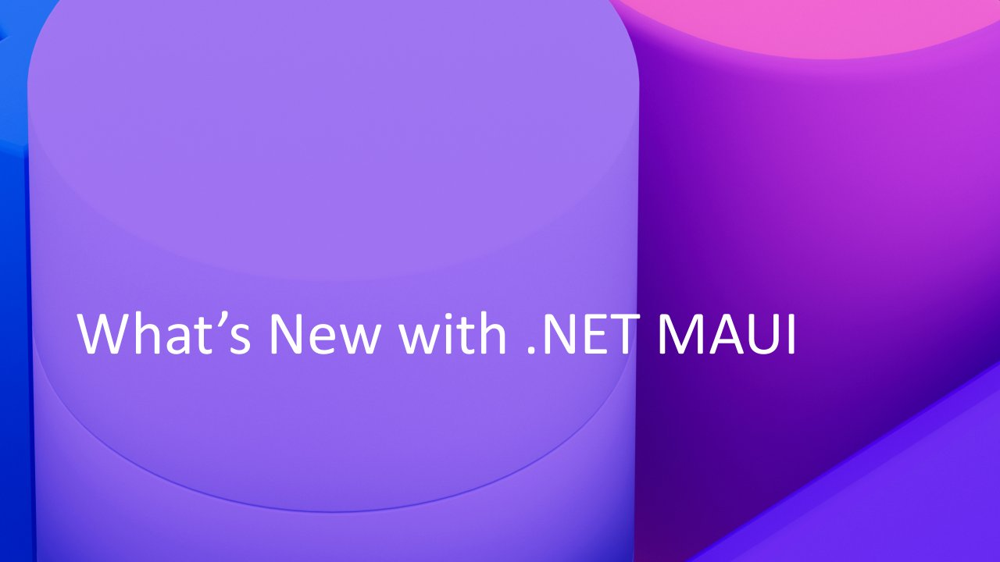

# What's New in .NET MAUI

**.NET Conf 2023** · Online · Tuesday 14 November 2023 · [Session page](https://learn.microsoft.com/en-us/shows/dotnetconf-2023/whats-new-in-dotnet-maui)

With [Maddy Montaquila](https://github.com/maddymontaquila).

## Abstract

> Companies worldwide are building mobile and desktop apps with .NET MAUI, and .NET 8 brings greater stability, memory management, and new desktop features to everyone. In this session, we’ll introduce you to what’s new in .NET 8, how companies are being successful shipping production quality applications with .NET MAUI, and how you can get the most out of Visual Studio and Visual Studio Code.

From the [session page](https://learn.microsoft.com/en-us/shows/dotnetconf-2023/whats-new-in-dotnet-maui).

## Slides

- [PDF](slides.pdf) (29 slides, 11.2 MB)
- [PowerPoint](https://github.com/davidortinau/presentations/releases/download/2023-11-14-dotnet-conf-whats-new-in-maui/2023-11-14-dotnet-conf-whats-new-in-maui.pptx) (76.5 MB). The speaker notes were reviewed for public sharing.

## Video

- [Recording](https://www.youtube.com/watch?v=4saU9BNY6l4)

## Demos

| Demo | Code | As presented |
|---|---|---|
| Point of Sale demo | [davidortinau/maui-samples](https://github.com/davidortinau/maui-samples/tree/dotnetconf2023), branch `dotnetconf2023` | [85675d0](https://github.com/davidortinau/maui-samples/tree/85675d031628d9b6fb4d2df3a080ea9567c2dd89) · [Point of Sale app](https://github.com/davidortinau/maui-samples/blob/85675d031628d9b6fb4d2df3a080ea9567c2dd89/7.0/Apps/PointOfSale) |

## Resources

- [.NET 8 Performance Improvements in .NET MAUI](https://devblogs.microsoft.com/dotnet/dotnet-8-performance-improvements-in-dotnet-maui/)
- [C# Dev Kit](https://aka.ms/csdevkit)
- [Download .NET 8](https://aka.ms/get-dotnet-8)

---

[All talks](../../README.md)
