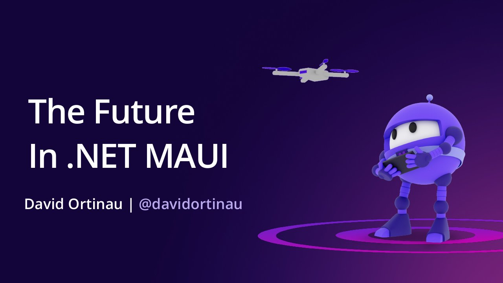

# The Future in .NET MAUI

**DevReach 2023** · November 2023

## Abstract

> Whether you're new to .NET MAUI or have been riding the waves since Microsoft shipped in .NET 6, David Ortinau shares how you can take advantage of a single codebase to build high-quality mobile and desktop applications for Android, iOS, macOS, and Windows.
>
> He also shares the roadmap for what is coming your way in .NET 8, and a vision for the future of .NET development for client applications.

From the [Official DevReach 2023 video description (Progress Telerik channel)](https://www.youtube.com/watch?v=w80d3TkIBWM).

## Slides

- [PDF](slides.pdf) (30 slides, 14.0 MB)
- [PowerPoint](https://github.com/davidortinau/presentations/releases/download/2023-11-devreach-future-in-maui/2023-11-devreach-future-in-maui.pptx) (156.3 MB). The speaker notes were reviewed for public sharing.

## Video

- [The Future in .NET MAUI | DevReach 2023 (Progress Telerik)](https://www.youtube.com/watch?v=w80d3TkIBWM)

## Resources

- [.NET Upgrade Assistant general availability (upgrading Xamarin.Forms to .NET MAUI)](https://devblogs.microsoft.com/dotnet/upgrade-assistant-general-availability/#upgrades-from-xamarin-forms-to-net-maui)
- [Multi-headed MAUI apps sample (Matthew Leibowitz)](https://github.com/mattleibow/MauiMultiHeadProject/)
- [Swift interop design proposal (dotnet/designs#302)](https://github.com/dotnet/designs/pull/302)
- [.NET presentations: .NET Conf decks](https://github.com/dotnet-presentations/home)

---

[All talks](../../README.md)
