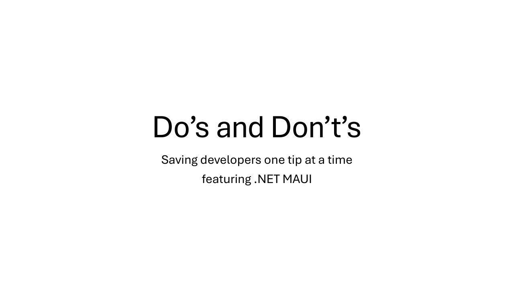

# .NET MAUI Do's and Don'ts

**.NET MAUI Community Standup** · Online · Thursday 1 February 2024 · [Session page](https://www.youtube.com/watch?v=IQbJPm1VBkg)

With [Maddy Montaquila](https://github.com/maddymontaquila).

A segment of the standup "MAUI Catch-up and Q+A!", starting at 49:15.

## Abstract

> Join David and Maddy to catch up on all things .NET MAUI - .NET 8 reception, .NET 9 planning, some of Maddy and David's "what not to do's", and the usual shenanigans. Plus, plenty of time for Q+A!

From the [video description](https://www.youtube.com/watch?v=IQbJPm1VBkg).

## Slides

- [PDF](slides.pdf) (15 slides, 0.1 MB)
- [PowerPoint](https://github.com/davidortinau/presentations/releases/download/2024-02-01-maui-community-standup-dos-and-donts/2024-02-01-maui-community-standup-dos-and-donts.pptx) (0.1 MB). This deck has no speaker notes.

## Video

- [The Do's and Don'ts segment (YouTube, from 49:15)](https://www.youtube.com/watch?v=IQbJPm1VBkg&t=2955s)

## Resources

- [.NET MAUI Do's and Don'ts, the write-up on DEV](https://dev.to/davidortinau/net-maui-dos-and-donts-19g3)
- [Community links from the standup](https://www.theurlist.com/maui-standup-feb2024)

---

[All talks](../../README.md)
