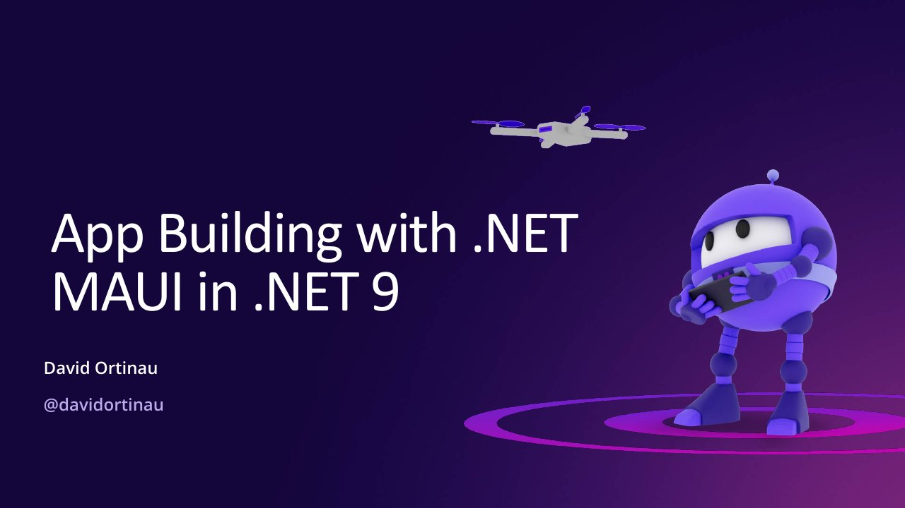

# App Building with .NET MAUI in .NET 9

**KC .NET User Group** · Quest Analytics, LLC, Overland Park, United States · Tuesday 23 July 2024, 18:00 · [Session page](https://www.meetup.com/kc-net-user-group/events/302162177)

## Abstract

> As .NET 8 continues to bring stability to .NET MAUI, and we navigate the sunsetting of Visual Studio for Mac and App Center, what does client app building look like next? In this session product manager David Ortinau will illuminate the .NET roadmap for client app development, and showcase new features and experiences for .NET MAUI in .NET 9 and Visual Studio Code. Hint: we are making your Android, iOS, Mac, and Windows apps faster and smaller, and helping you be even more productive along the way.

From the [session page](https://www.meetup.com/kc-net-user-group/events/302162177).

## Slides

- [PDF](slides.pdf) (72 slides, 15.0 MB)
- [PowerPoint](https://github.com/davidortinau/presentations/releases/download/2024-07-23-kc-dotnet-user-group-maui-net-9/2024-07-23-kc-dotnet-user-group-maui-net-9.pptx) (151.5 MB). The speaker notes were reviewed for public sharing.

## Video

No recording posted yet.

---

[All talks](../../README.md)
