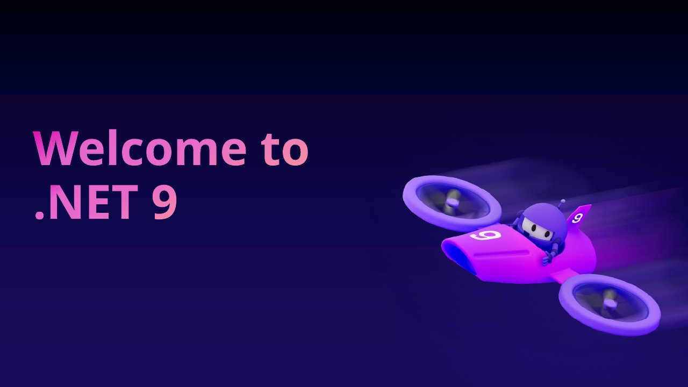

# Keynote: Welcome to .NET 9

**.NET Conf 2024** · Online · Tuesday 12 November 2024 · [Session page](https://learn.microsoft.com/en-us/shows/dotnet-conf-2024/keynote-welcome-to-dotnet-9)

With James Montemagno, Damian Edwards, [Maddy Montaquila](https://github.com/maddymontaquila), Maria Naggaga, Steve Sanderson, Safia Abdalla, Daniel Roth.

## Abstract

> .NET 9 is here elevating cloud-native and intelligent app development, focusing on productivity enhancements, streamlined deployments, and accelerated AI integration, ensuring superior performance for developers across various applications.

From the [session page](https://learn.microsoft.com/en-us/shows/dotnet-conf-2024/keynote-welcome-to-dotnet-9).

## Slides

- [PDF](slides.pdf) (59 slides, 14.3 MB)
- [PowerPoint](https://github.com/davidortinau/presentations/releases/download/2024-11-12-dotnet-conf-keynote-welcome-to-net-9/2024-11-12-dotnet-conf-keynote-welcome-to-net-9.pptx) (25.6 MB). The speaker notes were reviewed for public sharing.

## Video

- [Welcome to .NET 9 - .NET Conf 2024 Keynote (dotnet YouTube channel)](https://www.youtube.com/watch?v=ikSNL-lxolc)

## Resources

- [Performance Improvements in .NET 9](https://devblogs.microsoft.com/dotnet/performance-improvements-in-net-9/)
- [Get .NET 9](https://aka.ms/get-dotnet-9)
- [.NET Aspire Community Toolkit](https://github.com/CommunityToolkit/aspire)
- [Syncfusion Toolkit for .NET MAUI](https://github.com/syncfusion/maui-toolkit)

---

[All talks](../../README.md)
