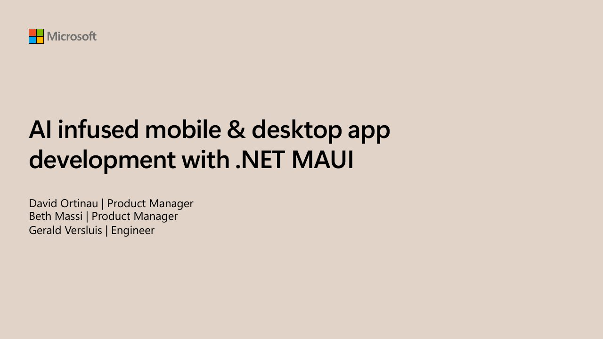

# BRK123 AI infused mobile & desktop app development with .NET MAUI

**Build 2025** · Seattle, United States · Thursday 22 May 2025

With [Beth Massi](https://github.com/BethMassi), [Gerald Versluis](https://github.com/jfversluis).

## Abstract

> .NET MAUI allows you to create multi-platform apps for iOS, Android, macOS, and Windows. See how you can boost your productivity with AI enhancements in GitHub Copilot and Visual Studio and learn how the entire development lifecycle is being transformed with .NET Aspire. Join us and see how intelligent productivity tools and beautiful controls and components come together to build native and hybrid apps with .NET MAUI's latest features.

From the [Official video description (Microsoft Developer channel)](https://www.youtube.com/watch?v=tFOFU7LDQlA).

## Slides

- [PDF](slides.pdf) (53 slides, 10.6 MB)
- [PowerPoint](https://github.com/davidortinau/presentations/releases/download/2025-05-22-build-brk123-ai-infused-maui/2025-05-22-build-brk123-ai-infused-maui.pptx) (38.5 MB). The speaker notes were reviewed for public sharing.

## Video

- [Recording on YouTube (Microsoft Developer), from my segment at 9:16](https://www.youtube.com/watch?v=tFOFU7LDQlA&t=556s)

## Demos

| Demo | Code | As presented |
|---|---|---|
| Telepathy task app | [davidortinau/telepathy](https://github.com/davidortinau/telepathy/tree/main), branch `main` | [db95eb6](https://github.com/davidortinau/telepathy/tree/db95eb6234817fccbd178fc0f3179df0fb7d2093) |

## Resources

- [Microsoft Build 2025](https://build.microsoft.com)
- [Nielsen Norman Group: AI paradigm](https://www.nngroup.com/articles/ai-paradigm/)

---

[All talks](../../README.md)
