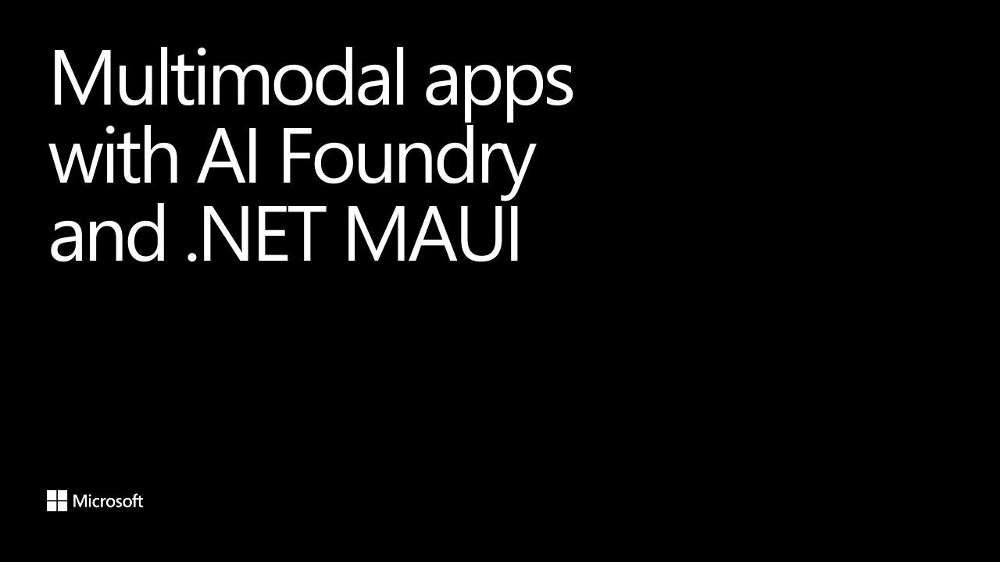

# Multimodal Apps with AI Foundry and .NET MAUI

**Azure Dev Summit 2025** · Lisbon Exhibition and Congress Centre (FIL), Lisbon, Portugal · Tuesday 14 October 2025

## Abstract

> It's easier than ever to develop intelligent apps for mobile and desktop using Azure AI Foundry and .NET.
>
> In this session I'll show you how to add support for voice, vision, and more with the power of the latest LLMs and on device models everywhere your app runs across web, mobile, and desktop.

From the [Official video description (Azure Dev Summit channel)](https://www.youtube.com/watch?v=5L9RAnNPoLw).

## Slides

- [PDF](slides.pdf) (52 slides, 19.1 MB)
- [PowerPoint](https://github.com/davidortinau/presentations/releases/download/2025-10-14-azure-dev-summit-multimodal-foundry-maui/2025-10-14-azure-dev-summit-multimodal-foundry-maui.pptx) (107.6 MB). The speaker notes were reviewed for public sharing.

## Video

- [Multimodal Apps with AI Foundry and .NET MAUI - David Ortinau - Azure Dev Summit 2025](https://www.youtube.com/watch?v=5L9RAnNPoLw)

## Also presented at

- [Swetugg Stockholm 2026, Tuesday 3 February 2026](../../2026/2026-02-03-swetugg-multimodal-foundry-maui/)

---

[All talks](../../README.md)
