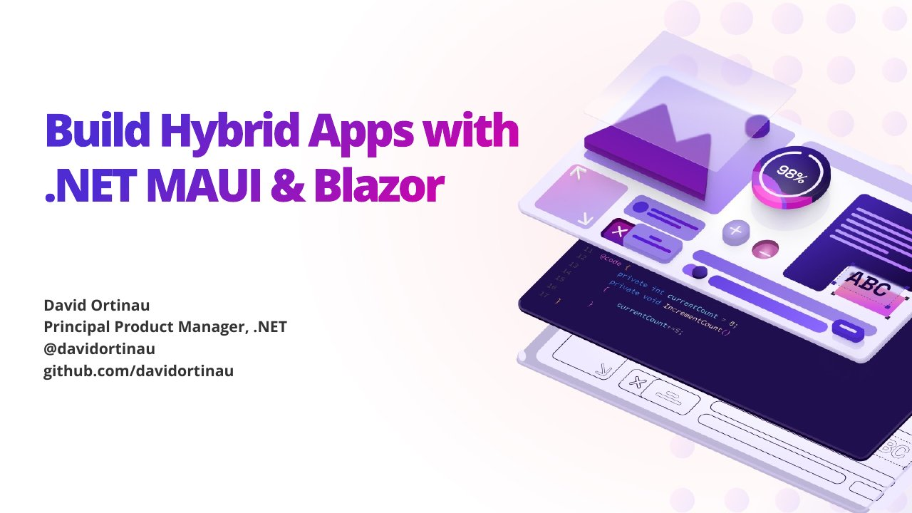

# Blazor Everywhere

**Swetugg Stockholm 2026** · Lustikulla Konferens & Event, Stockholm, Sweden · Wednesday 4 February 2026, 12:50 · [Session page](https://swetugg-v2-web-app-ava3f0dgcnana0dj.swedencentral-01.azurewebsites.net/Stockholm/2026/sessions/blazor-everywhere)

## Abstract

> Ever since we introduced .NET MAUI we have heard the same chorus of celebration: developers love Blazor Hybrid with .NET MAUI! And we continue to add and improve the experience with every release. In this session I'll cover the breadth of what you can do with a hybrid solution, from maximizing your code share across platforms to plumbing the depths of native device features. You may be astonished just how great the apps can be!

From the [session page](https://swetugg-v2-web-app-ava3f0dgcnana0dj.swedencentral-01.azurewebsites.net/Stockholm/2026/sessions/blazor-everywhere).

## Slides

- [PDF](slides.pdf) (14 slides, 9.2 MB)
- [PowerPoint](https://github.com/davidortinau/presentations/releases/download/2026-02-04-swetugg-blazor-everywhere/2026-02-04-swetugg-blazor-everywhere.pptx) (116.6 MB). The speaker notes were reviewed for public sharing.

## Video

No recording posted yet.

## Demos

| Demo | Code | As presented |
|---|---|---|
| BlazorCanDoEverything | [davidortinau/BlazorCanDoEverything](https://github.com/davidortinau/BlazorCanDoEverything/tree/main), branch `main` | [ae1dee2](https://github.com/davidortinau/BlazorCanDoEverything/tree/ae1dee24ca8d97b77543f4c85846aa12fcf5280f) |

## Resources

- [Hybrid apps in .NET MAUI documentation](https://learn.microsoft.com/dotnet/maui/hybrid-apps)
- [BlazorCanDoEverything demo](https://github.com/davidortinau/BlazorCanDoEverything)
- [Nielsen Norman Group: The 3rd UI paradigm of AI](https://www.nngroup.com/articles/ai-paradigm/)

---

[All talks](../../README.md)
