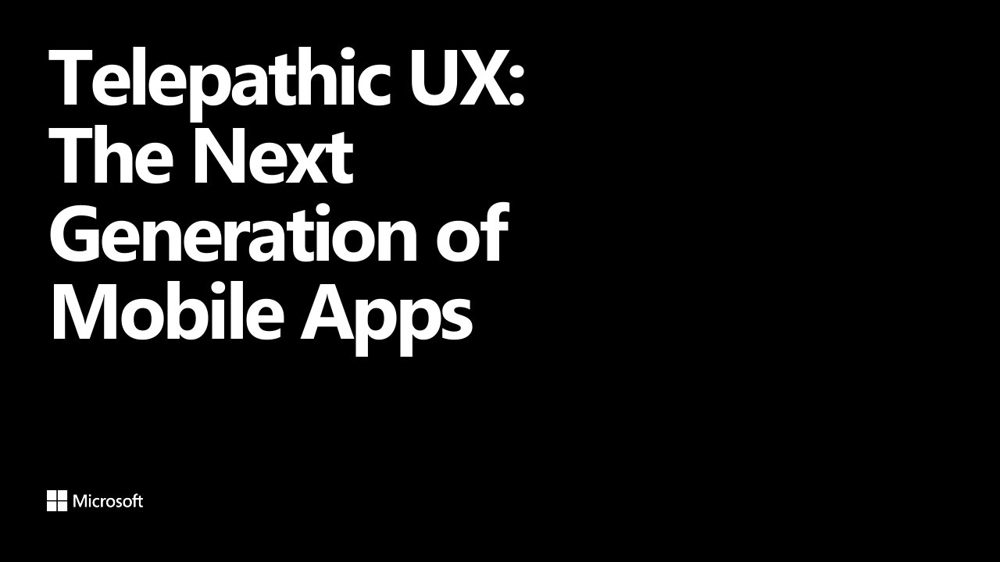

# Telepathic UX: The Next Generation of Mobile Apps

**Update Conference Kraków 2026** · Hall C, Kraków, Poland · Thursday 28 May 2026, 09:00 · 60 minutes · [Session page](https://krakow.updateconference.net/en/2026/schedule/telepathic-ux-the-next-generation-of-mobile-apps)

## Abstract

> As AI becomes cheaper, smaller, faster, and generally more consistent it will be used more ubiquitously in our applications. Mobile devices are primed to be the pinnacle of these experiences due to their multi-modal capabilities, and contextual presence. Are you ready to deliver these types of applications? In this session we'll peer into the near future at what's to come, and showcase how you can get started today designing and building applications with intelligence that borders on precognition.

From the [session page](https://krakow.updateconference.net/en/2026/schedule/telepathic-ux-the-next-generation-of-mobile-apps).

## Slides

- [PDF](slides.pdf) (25 slides, 1.5 MB)
- [PowerPoint](https://github.com/davidortinau/presentations/releases/download/2026-05-28-update-conference-krakow-telepathic-ux/2026-05-28-update-conference-krakow-telepathic-ux.pptx) (13.7 MB). The speaker notes were reviewed for public sharing.

## Video

No recording posted yet.

## Also presented at

- [Azure Dev Summit 2025, October 2025](../../2025/2025-10-azure-dev-summit-telepathic-ux/)

## Resources

- [Nielsen Norman Group: The 3rd UI paradigm of AI](https://www.nngroup.com/articles/ai-paradigm/)
- [Plugin.Maui.Audio](https://github.com/jfversluis/Plugin.Maui.Audio)
- [SpeechToText in .NET MAUI Community Toolkit](https://learn.microsoft.com/dotnet/communitytoolkit/maui/essentials/speech-to-text)

---

[All talks](../../README.md)
