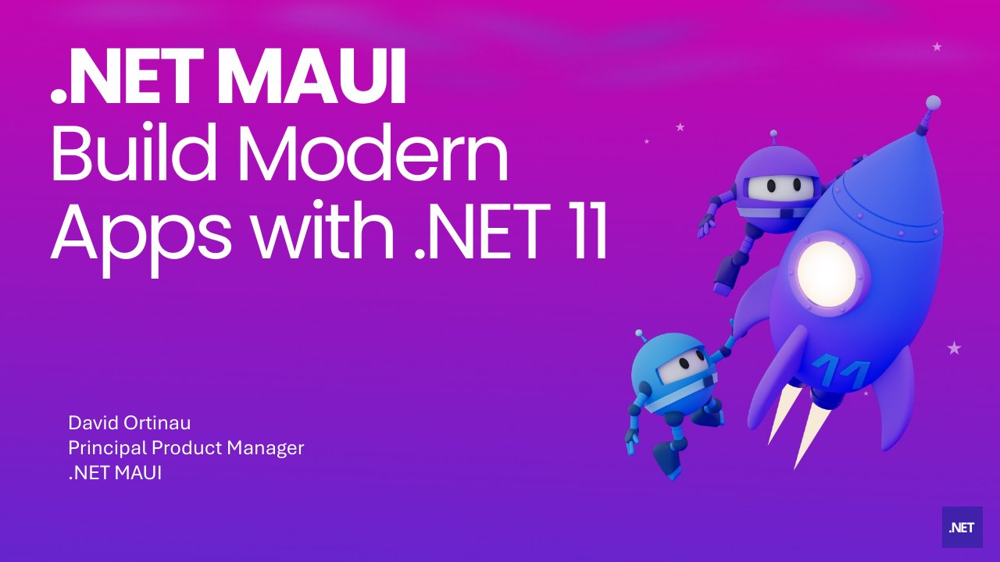

# Build Modern .NET MAUI Apps with .NET 11

**Syncfusion webinar** · Online · Thursday 10 September 2026, 10:00 ET · 71 minutes · [Session page](https://www.syncfusion.com/webinars/build-modern-net-maui-apps-with-net-11/)

## Abstract

> .NET MAUI continues to evolve as Microsoft focuses on improving performance, reliability, developer productivity, and the native application experience across Android, iOS, Mac Catalyst, and Windows.
>
> In this webinar, Principal Product Manager David Ortinau from Microsoft explored the improvements arriving with .NET MAUI in .NET 11 and demonstrated how developers can begin applying them to real cross-platform applications.
>
> From a new runtime foundation and XAML improvements to navigation, gestures, maps, security, and updated Syncfusion controls, .NET 11 introduces changes throughout the development experience.

From the [Syncfusion webinar page](https://www.syncfusion.com/webinars/build-modern-net-maui-apps-with-net-11/).

## Slides

- [PDF](slides.pdf) (25 slides, 4.2 MB)
- [PowerPoint](https://github.com/davidortinau/presentations/releases/download/2026-09-10-syncfusion-webinar-maui-net-11/2026-09-10-syncfusion-webinar-maui-net-11.pptx) (19.3 MB). The speaker notes were reviewed for public sharing.
- [Slides in the webinar repository](https://github.com/davidortinau/SyncfusionMaui11Webinar/tree/main/slides)

## Video

- [Recording on YouTube (Syncfusion)](https://www.youtube.com/watch?v=ExRWMGpm1rc)

## Demos

| Demo | Code | As presented |
|---|---|---|
| Webinar demo app (.NET 11 RC1 with Syncfusion .NET MAUI Toolkit) | [davidortinau/SyncfusionMaui11Webinar](https://github.com/davidortinau/SyncfusionMaui11Webinar/tree/main), branch `main` | Published after the webinar |

## Resources

- [Syncfusion show notes with time stamps](https://www.syncfusion.com/blogs/post/build-maui-apps-dot-net-11-webinar)
- [.NET MAUI in .NET 11 RC1 release notes](https://github.com/dotnet/core/blob/main/release-notes/11.0/preview/rc1/dotnetmaui.md)
- [What's new in .NET MAUI for .NET 11](https://learn.microsoft.com/en-us/dotnet/maui/whats-new/dotnet-11?view=net-maui-11.0)
- [Syncfusion .NET MAUI Toolkit v1.0.11](https://github.com/syncfusion/maui-toolkit/releases/tag/v1.0.11)
- [DeveloperBalance sample](https://github.com/dotnet/maui-samples/tree/e78b47511ac706bb179abc4a09f182355ae75178/10.0/Apps/DeveloperBalance)

---

[All talks](../../README.md)
