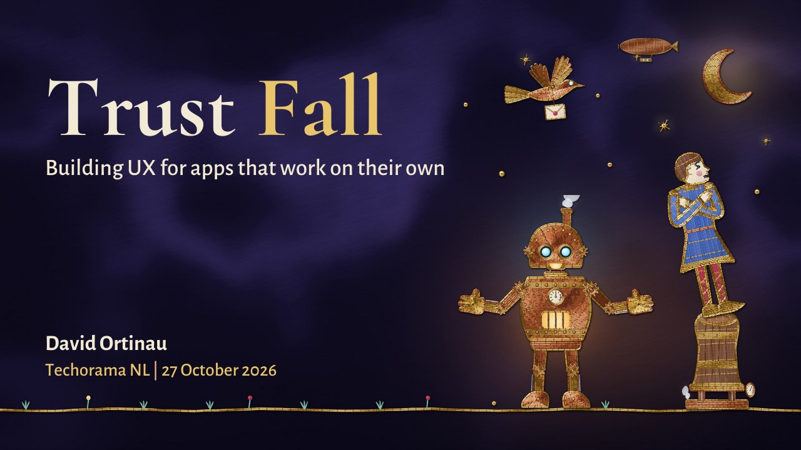

# Trust Fall: Building UX for Apps that work on their own

**Techorama NL 2026** · Kinepolis Jaarbeurs Utrecht, Utrecht, Netherlands · Tuesday 27 October 2026, 16:00 · 60 minutes · [Session page](https://www.techorama.nl/schedule/sessions/1241884)

## Abstract

> AI has gone beyond the chat window. It is making decisions on your behalf, whether you are watching or not. The difference between this story being a horror thriller and an adventure full of whimsy is none other than the protagonist: you.
>
> How much users trust any app has everything to do with how it is implemented, the patterns and practices of sound engineering and user interaction design that have always mattered. In this session we'll work through the design patterns shaping agentic UX in 2026: progress ledgers, confidence signals, sandbox previews, autonomy gradients, and the art of the well-placed human-in-the-loop. We'll look at examples of where it is going right, and where it has been frighteningly wrong.
>
> I'll show you have to implement these patterns using .NET MAUI, Blazor, Microsoft.Extensions.AI, and the Microsoft Agent Framework across mobile, desktop, and web — and you'll leave with a clear engineering recipe for shipping agents your users actually trust.

From the [session page](https://www.techorama.nl/schedule/sessions/1241884).

## Slides

- [PDF](slides.pdf) (24 slides, 19.6 MB)
- [PowerPoint](https://github.com/davidortinau/presentations/releases/download/2026-10-27-techorama-nl-trust-fall/2026-10-27-techorama-nl-trust-fall.pptx) (44.0 MB). The speaker notes were reviewed for public sharing.

## Video

No recording posted yet.

## Demos

| Demo | Code | As presented |
|---|---|---|
| Barista Notes reorder agent (Mac Catalyst app under Aspire, €100 budget) | [davidortinau/BaristaNotes](https://github.com/davidortinau/BaristaNotes/tree/005-reorder-agent), branch `005-reorder-agent` | [403b0a8](https://github.com/davidortinau/BaristaNotes/tree/403b0a8ec1fd733a67e312bbc7c4c4eb80f92f6a) · [Demo runbook](https://github.com/davidortinau/BaristaNotes/blob/403b0a8ec1fd733a67e312bbc7c4c4eb80f92f6a/specs/005-reorder-agent/demo-runbook.md) · [Plan](https://github.com/davidortinau/BaristaNotes/blob/403b0a8ec1fd733a67e312bbc7c4c4eb80f92f6a/specs/005-reorder-agent/plan.md) |

## Resources

- [TechCrunch: A Meta AI security researcher said an OpenClaw agent ran amok on her inbox](https://techcrunch.com/2026/02/23/a-meta-ai-security-researcher-said-an-openclaw-agent-ran-amok-on-her-inbox/)
- [Microsoft customer story: Direct Pojišťovna and Azure Document Intelligence](https://www.microsoft.com/en/customers/story/26862-direct-pojistovna-azure-document-intelligence-in-foundry-tools)
- [Shneiderman's Eight Golden Rules of Interface Design](https://www.cs.umd.edu/users/ben/goldenrules.html)
- [Nielsen Norman Group: 10 Usability Heuristics](https://www.nngroup.com/articles/ten-usability-heuristics/)
- [Microsoft Research: Guidelines for Human-AI Interaction](https://www.microsoft.com/en-us/research/publication/guidelines-for-human-ai-interaction/)
- [Slovic (1973), conference paper (PDF)](https://scholarsbank.uoregon.edu/server/api/core/bitstreams/148958f5-1fc5-419d-a56d-8c4583aa4fb5/content)
- [Dietvorst, Simmons, and Massey, algorithm aversion manuscript (PDF)](https://repository.upenn.edu/server/api/core/bitstreams/ac9f1367-c0e9-4a52-a90b-c7e30e6c4910/content)

---

[All talks](../../README.md)
