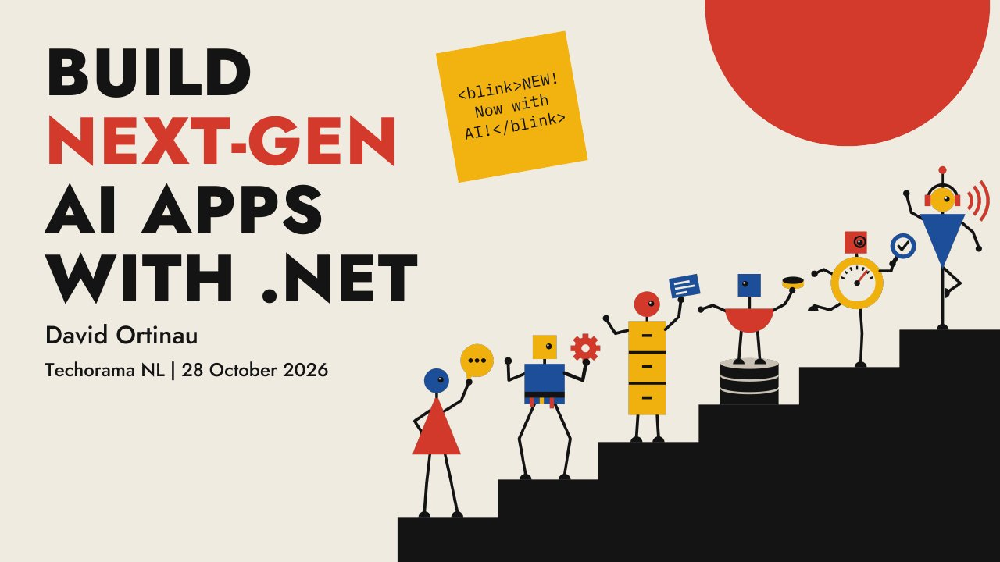

# Build Next-Gen AI Apps with .NET

**Techorama NL 2026** · Kinepolis Jaarbeurs Utrecht, Utrecht, Netherlands · Wednesday 28 October 2026, 11:15 · 60 minutes · [Session page](https://www.techorama.nl/schedule/sessions/1240554)

## Abstract

> Since the earliest days of the internet where rules were yet to be defined, there has never been a more exciting time to build apps. Let's move beyond the < blink > tag of AI and get into the details of what .NET provides to build truly transformational applications that use AI. My team produces the libraries you use to talk to models, define agents, build memory, ground in data, use eval to constantly improve them, talk in real time, and so much more.
>
> In this session you'll see some inspirational demos of what is possible, learn what is available today from .NET, and get insight into the .NET roadmap for AI directly from the product team.

From the [session page](https://www.techorama.nl/schedule/sessions/1240554).

## Slides

- [PDF](slides.pdf) (21 slides, 2.6 MB)
- [PowerPoint](https://github.com/davidortinau/presentations/releases/download/2026-10-28-techorama-nl-next-gen-ai-apps/2026-10-28-techorama-nl-next-gen-ai-apps.pptx) (2.3 MB). The speaker notes were reviewed for public sharing.

## Video

No recording posted yet.

## Demos

| Demo | Code | As presented |
|---|---|---|
| Sentence Studio (agents, memory, evaluation, realtime voice, Aspire) | [davidortinau/SentenceStudio](https://github.com/davidortinau/SentenceStudio/tree/techorama/next-gen-demos), branch `techorama/next-gen-demos` | [8706074](https://github.com/davidortinau/SentenceStudio/tree/87060745e9a63f0f9e80739989b1e5d80e0d0ace) · [Demo seed script](https://github.com/davidortinau/SentenceStudio/blob/87060745e9a63f0f9e80739989b1e5d80e0d0ace/scripts/techorama/seed-demo-learner.sh) |

## Resources

- [Microsoft customer story: Direct Pojišťovna and Azure Document Intelligence](https://www.microsoft.com/en/customers/story/26862-direct-pojistovna-azure-document-intelligence-in-foundry-tools)
- [Microsoft Agent Framework: Harness Agent](https://learn.microsoft.com/agent-framework/concepts/harness)
- [Microsoft.Extensions.AI evaluation libraries](https://learn.microsoft.com/dotnet/ai/evaluation/libraries)
- [What's new in .NET 11](https://learn.microsoft.com/dotnet/core/whats-new/dotnet-11/overview)
- [Lukac et al., Ambient AI Scribes in Clinical Practice: A Randomized Trial (NEJM AI, 2025)](https://doi.org/10.1056/AIoa2501000)

---

[All talks](../../README.md)
